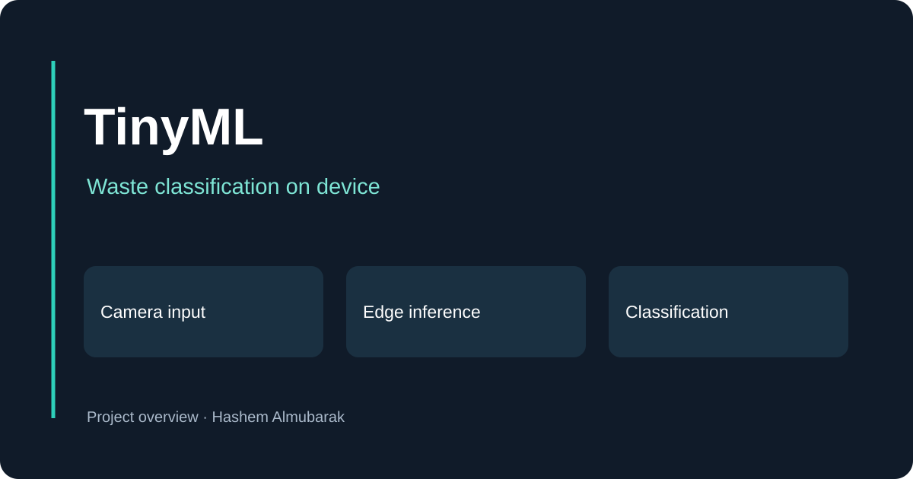

# Nicla Vision Waste Classification

An embedded image-classification project using Arduino Nicla Vision and Edge Impulse. This repository contains the exported Arduino inference library, model assets and device examples.

## Explore the implementation

- Camera example: `examples/nicla_vision/nicla_vision_camera/nicla_vision_camera.ino`
- Inference library: `src/`
- Library metadata: `library.properties`

The export includes examples for several development boards. The Nicla Vision camera example is the relevant starting point for this project.

## Run on a board

1. Download this repository as a ZIP.
2. In Arduino IDE, use **Sketch → Include Library → Add .ZIP Library** to import the library.
3. Select Arduino Nicla Vision and the connected board port.
4. Open the Nicla Vision camera example and upload it.
5. Inspect the serial output for inference results.

A physical board and its compatible Arduino board package are required. Classification quality depends on camera conditions and the model's training data; this repository does not provide a validated real-world accuracy benchmark.

[More projects](https://hashem-m-almubarak-portfolio.vercel.app/) · [LinkedIn](https://www.linkedin.com/in/hashem-almubarak/)
